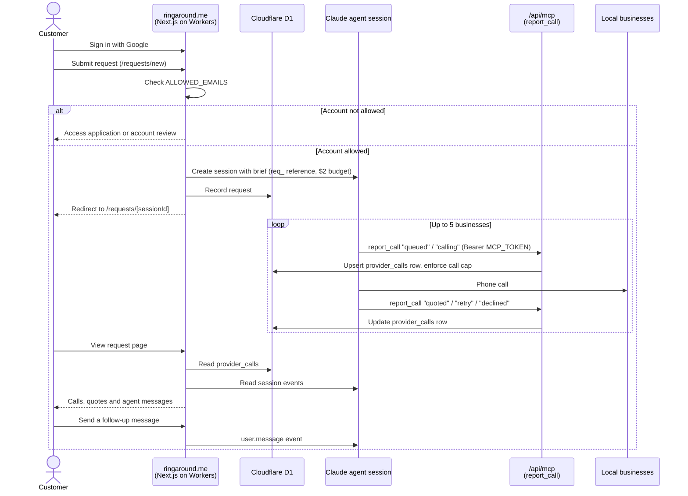

# RingAround web frontend

**Website: [ringaround.me](https://ringaround.me)**

RingAround gets quotes from local service providers by phone. A customer describes the job once, and an AI agent finds nearby businesses, calls them, and reports back what each one said. This repository is the website at [ringaround.me](https://ringaround.me): sign-in, the request form, request tracking, and the MCP endpoint the agent reports calls to.

It is a [Next.js](https://nextjs.org) 16 app (App Router) running on Cloudflare Workers through [OpenNext for Cloudflare](https://opennext.js.org/cloudflare), with user data in Cloudflare D1 and calls placed by a [Claude Managed Agents](https://docs.claude.com) agent.

## How a request flows



## Project layout

| Path | What it holds |
| --- | --- |
| `app/` | Routes: home page, `/sign-in`, `/requests` (list, new, detail), `/apply`, `/account/pending`, and the API routes for Auth.js and MCP |
| `components/` | Shared UI: header, navigation, theme toggle, form parts, icons |
| `lib/agent.js` | Starts and reads agent sessions, writes the brief, gates calls by `ALLOWED_EMAILS` (server only) |
| `lib/db.js` | D1 access for profiles, saved locations, applications, requests and provider calls |
| `lib/` (other) | Request validation and formatting, service categories, theme helpers |
| `auth.js` | NextAuth.js v5 config with Google OAuth |
| `migrations/` | D1 schema, applied before every deploy |
| `skills/ringaround/SKILL.md` | The skill the calling agent works from, uploaded on each production deploy |
| `scripts/` | `connect-agent.mjs` (links the agent to `/api/mcp`) and `deploy-skill.mjs` (uploads the skill) |
| `docs/` | Longer guides: [authentication](docs/authentication.md) and [deployment](docs/deployment.md) |

## Getting started

```bash
npm install
npm run db:migrate:local   # create the local D1 tables (once)
npm run dev
```

Open [http://localhost:3000](http://localhost:3000). Google sign-in needs `AUTH_GOOGLE_ID`, `AUTH_GOOGLE_SECRET`, `AUTH_SECRET` and `AUTH_URL` in `.env.local`; see [docs/authentication.md](docs/authentication.md). Without them, the sign-in page shows as unavailable. Starting real calls also needs the `CLAUDE_*` values and `ALLOWED_EMAILS` described in [docs/deployment.md](docs/deployment.md).

## Scripts

| Command | What it does |
| --- | --- |
| `npm run dev` | Plain `next dev` |
| `npm run build` | `next build` |
| `npm run lint` | ESLint |
| `npm run preview` | OpenNext build, then serve it locally in workerd |
| `npm run deploy` | Build and deploy production from your machine (needs `wrangler login`) |
| `npm run db:migrate:local` | Apply D1 migrations to the local database |

## Deployment

`.github/workflows/deploy.yml` deploys on every push to `main` (production at ringaround.me) and gives each pull request its own preview Worker, deleted when the PR closes. Previews use a separate D1 database and never get agent credentials, so they can't place real calls. Setup, secrets, migrations and the agent skill are covered in [docs/deployment.md](docs/deployment.md).

## Notes for contributors

- This Next.js version differs from older releases. Check the guides in `node_modules/next/dist/docs/` before relying on familiar APIs (see `AGENTS.md`).
- D1 migrations must be additive, because the previous Worker keeps serving while they run.
- `cacheComponents` is off in `next.config.mjs`; pages hang under OpenNext with it on.
